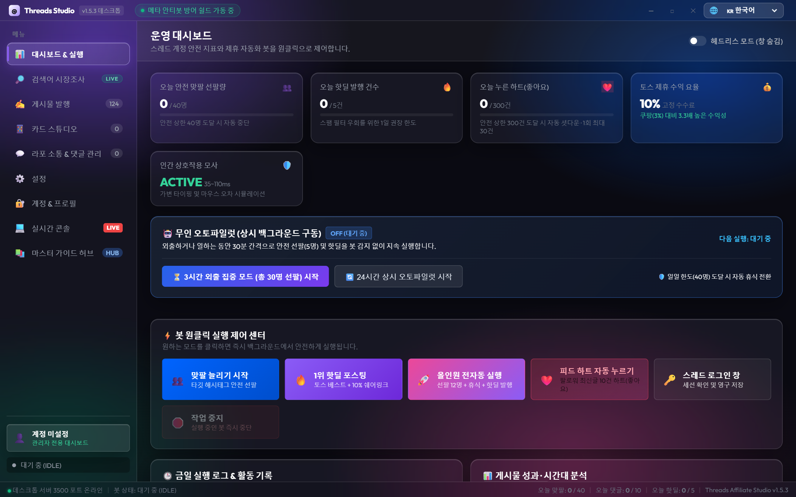
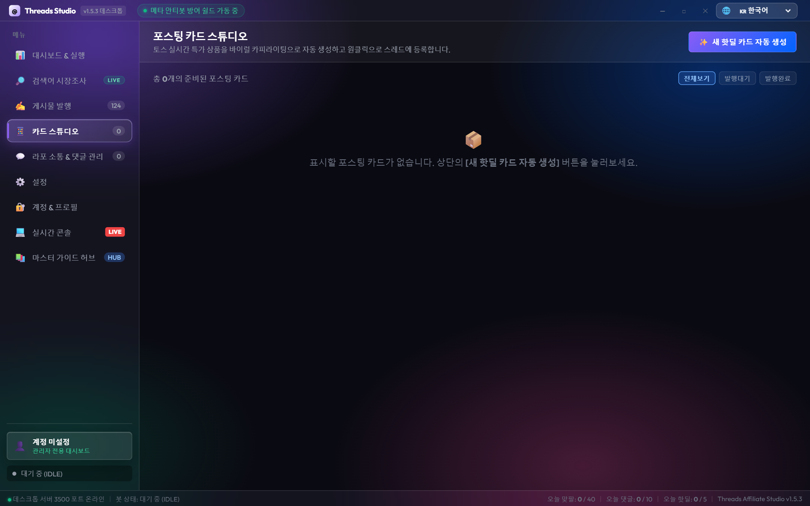
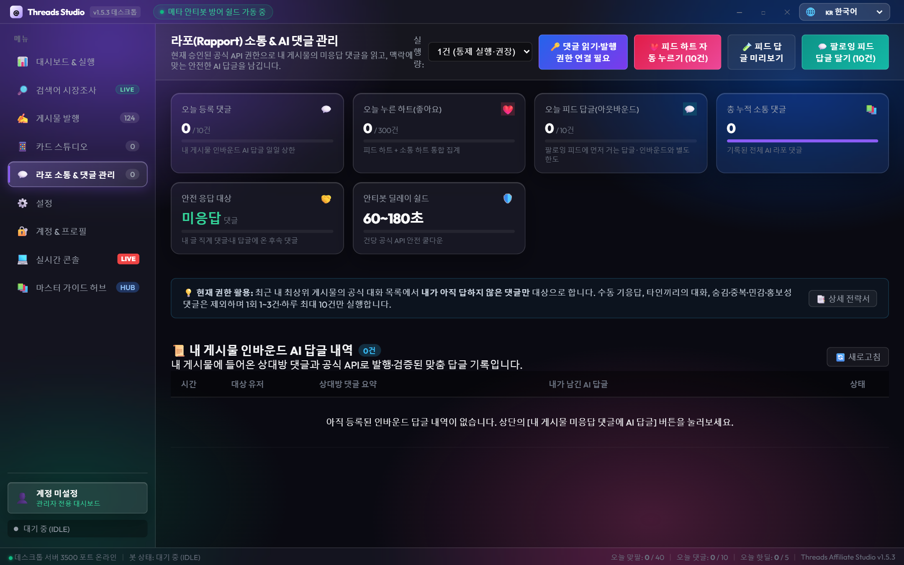
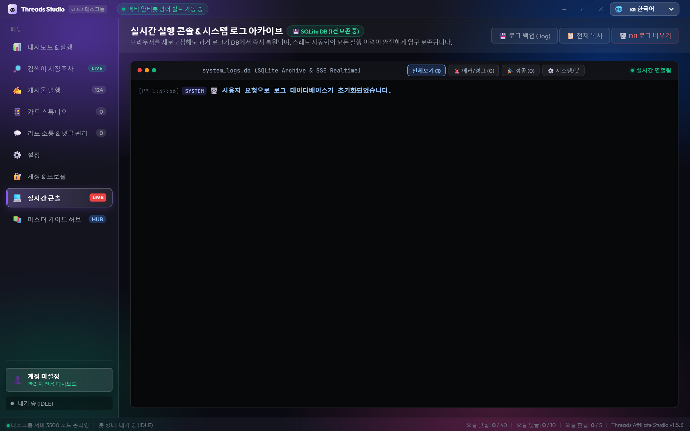

# Threads Affiliate Automation

An open-source toolkit for creating and managing Threads affiliate content. Use the local dashboard to design content cards, prepare posts, and manage supported Threads API or browser-session workflows.

> New here? See the screenshots, then follow [Quick Start](#quick-start). Review every post and reply before publishing. Follow Threads' current Terms and API policies. Activity limits do not guarantee protection from account restrictions.

> 💡 **Notice**: A **Google Gemini API Key** (Free tier available) is required for AI-tailored comments and card image generation. Basic follow growth and hot-deal posting can run without an API key.

[한국어](docs/i18n/README_ko.md) · [English](#) · [日本語](docs/i18n/README_ja.md) · [简体中文](docs/i18n/README_zh.md) · [Español](docs/i18n/README_es.md) · [Deutsch](docs/i18n/README_de.md) · [Français](docs/i18n/README_fr.md) · [Português](docs/i18n/README_pt.md)

## Preview

### Dashboard


### Affiliate Card Studio


### Rapport and Comments


### Live Console


## Features

- **Content and engagement tools:** contextual reply styles, feed keyword analysis, and content presets.
- **Local dashboard:** activity overview, card studio, account and settings pages, and live logs. Interface supports eight languages.
- **Affiliate workflow:** product collection, affiliate-link handling, and post composition with disclosure support.
- **Threads integrations:** Meta Threads Graph API and Playwright browser-session workflows, depending on configuration.
- **Controls:** configurable daily activity limits and delays. They do not prevent platform enforcement.

## Quick Start

### Requirements
- Node.js 18 or later
- Google Chrome
- **Google Gemini API Key** (Free to generate at [Google AI Studio](https://aistudio.google.com/))

### Install and run

```bash
git clone https://github.com/nerin81-netizen/threads-affiliate-automation.git
cd threads-affiliate-automation
npm install
cp .env.example .env
npm start
```

Add only the credentials you need to .env. Keep that file private and never commit secrets. Open http://localhost:3500. For deployment details, see [DEPLOY.md](DEPLOY.md).

## Project Files
- [Changelog](CHANGELOG.md)
- [Deployment guide](DEPLOY.md)
- [License](LICENSE)

## License
Released under the [MIT License](LICENSE).

## Disclaimer

This independent project is not affiliated with or endorsed by Meta, Threads, Toss, or Naver. You are responsible for complying with each platform's current Terms of Service and API policies. Clearly disclose material connections when publishing affiliate links, as required by applicable advertising rules.


